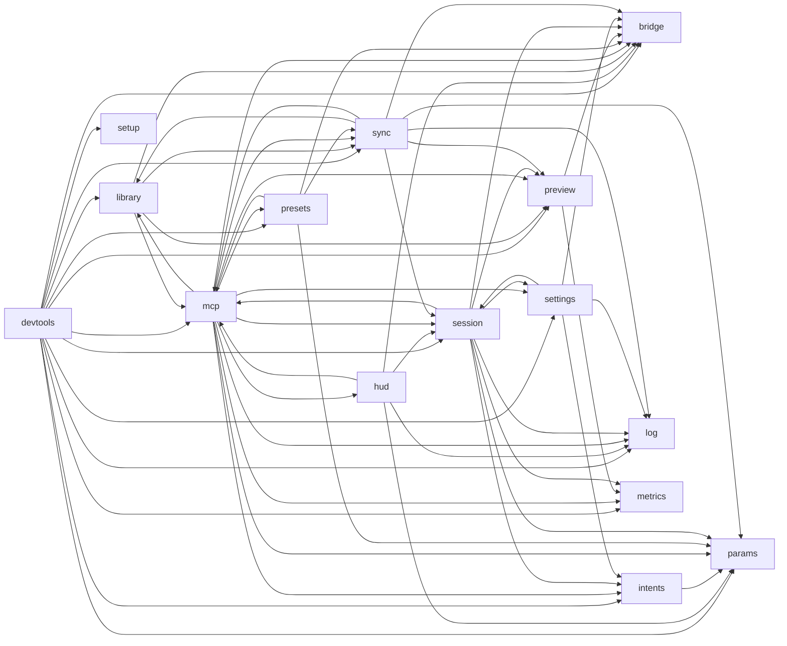

# engine\src module graph

Generated by `npm run arch:graph`; do not edit. One node per module of the CLAUDE.md "Module Map", one arrow per module it imports. Arrows into `mcp` from modules other than `devtools` are imports of `mcp/errors.ts` only (rule `mcp-errors-only`).

